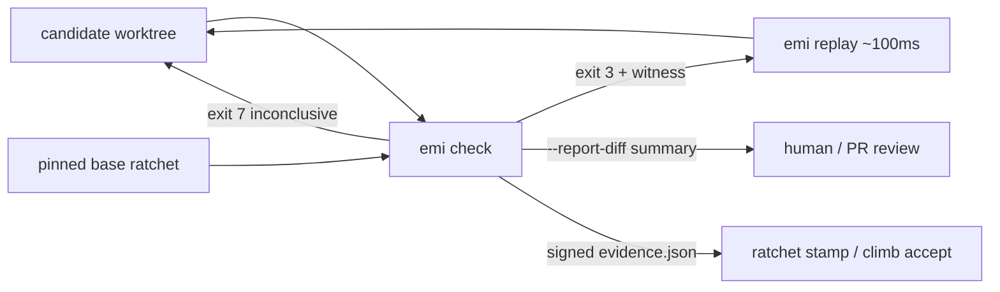

# emi

A small, agentic-first Rust CLI that checks what a code change actually does to your program's behavior — whether by running your program/CLI directly (`--cmd`), comparing public functions automatically in Python & JS/TS, or summarizing behavioral diffs for PR review (`--report-diff`).

Zero external crate dependencies. Ships as static Linux binaries (no Rust needed) or builds in seconds with `cargo build --release`. See [GUIDE.md](GUIDE.md) for a step-by-step usage walkthrough (whole-program `--cmd` mode, `--report-diff` review mode, agent loop, CI evidence stamping, observable effects, `climb`, and custom drivers).

## Why

When an agent edits a repo and writes tests for its own patch, those tests often confirm the same misunderstanding as the patch itself.

`emi` checks the change directly against a pinned baseline commit:

1. **Whole-program or function-level:** Run arbitrary commands (`--cmd "python3 app.py ..."`, `--cmd "npm run build"`, etc.) across any language, OR let `emi` auto-drive Python and JS/TS modules function by function with zero setup.
2. **Refactor gate OR behavior-diff review:** By default `emi check` enforces behavioral equivalence for refactors and speedups; pass `--report-diff` on feature/bug-fix PRs to get a minimal shrunk summary of what changed (exit `0`) instead of a hard failure.
3. **Determinism & isolation first:** Runs `base` against itself twice and `candidate` against itself twice in isolated snapshots (with `node_modules` symlinked and `src/` layouts supported) before trusting any comparison.
4. **Constant mining, shrinking & AST mutations:** Mines constants from changed files, imported modules, and rule bounds; shrinks divergences without collapsing unapproved bugs into approved rule ranges; and mutates executable changed lines in the AST to verify the oracle actually catches real bugs.
5. **Tamper-resistant pinned policy:** Reads rules, masks, commands, observable-effect declarations, and regression workflows from the pinned `base` commit (`git show <base>:.emi/ratchet.json`), overlays base driver/harness files into candidate snapshots, and binds signed evidence records to the exact candidate tree, driver, and policy.



## Install (including cloud AI sessions)

**Linux / macOS** (downloads the verified static prebuilt binary from GitHub Releases — works in Ubuntu/Debian/Alpine cloud sandboxes with no Rust toolchain needed, falling back to `cargo` if unavailable):

```bash
curl -fsSL https://raw.githubusercontent.com/andrejksi/emiv2/main/install.sh | sh
```

To install into a custom directory (e.g. `/usr/local/bin`) or pin a specific release tag (`edge` or `v*`):

```bash
EMI_INSTALL_DIR=/usr/local/bin EMI_VERSION=edge \
  curl -fsSL https://raw.githubusercontent.com/andrejksi/emiv2/main/install.sh | sh
```

**Windows (PowerShell)**:

```powershell
irm https://raw.githubusercontent.com/andrejksi/emiv2/main/install.ps1 | iex
```

**Cargo**:

```bash
cargo install --force --git https://github.com/andrejksi/emiv2
```

**Docker**:

```bash
docker build -t emi https://github.com/andrejksi/emiv2.git
docker run --rm -v "$PWD:/workspace" emi check --repo /workspace --base origin/main --json
```

**From source**:

```bash
cargo build --release
```

To run the built-in simulation and end-to-end suite (1,000 seeded in-memory worlds plus 65 effectful and black-box CLI worlds covering trust boundaries, whole-program `--cmd` mode, `--report-diff`, driver tamper resistance, Node/TS ESM & `node_modules`, Python `src/` layouts, and field regressions):

```bash
emi sim --seeds 1000
```

## Quickstart

### 1. Whole-program / CLI verification (`--cmd`, any language)

Compare real end-to-end commands on `base` vs `candidate` (stdout, stderr, exit code, and declared `--observe-file` outputs):

```bash
emi check --repo . --base origin/main \
  --cmd "python3 cli.py --input sample.json" \
  --observe-file out/report.json \
  --json
```

Pin commands on your base branch so CI enforces them:

```bash
emi ratchet init --repo . --mode enforce --allow-head \
  --cmd "python3 .emi/smoke_check.py" \
  --observe-file out/report.json
git add .emi/ && git commit -m "pin emi commands"
```

### 2. Review behavioral changes on feature / bug-fix PRs (`--report-diff`)

When behavior *is* supposed to change, use `--report-diff` to get shrunk minimal input/output witnesses for review (exits `0` with `verdict: "behavior_changed"`, and cannot pass a strict `ratchet stamp`):

```bash
emi check --repo . --base origin/main --report-diff --json
```

### 3. Strict refactor / speedup gate + fast witness replay

Initialize a ratchet file and commit it on your base branch:

```bash
emi ratchet init --repo . --mode enforce --allow-head \
  --min-cov-ratio 0.5 \
  --observe-file journal.log \
  --require-workflow select-post-release \
  --require-mutations
git add .emi/ratchet.json && git commit -m "init emi ratchet"
```

Run the single-shot verification gate (`--strict` is on by default; pass `--no-strict` to relax):

```bash
EMI_SIGNING_KEY="$CI_KEY" emi check --repo . --base origin/main --seeds 48 --json
```

If `emi check` returns exit `3`, iterate quickly against only the failing shrunk witness with `emi replay` before re-running the full check:

```bash
emi replay --repo . --base origin/main --evidence .emi/evidence.json --json
```

When `emi check` returns exit `0` (`pass`), stamp the signed attestation from the exact verified evidence record:

```bash
EMI_SIGNING_KEY="$CI_KEY" emi ratchet stamp --repo . --base origin/main --evidence .emi/evidence.json
```

## Key commands

- `emi check` — single-shot pipeline (public-API skeleton + strict behavioral diff + adversary mutations + signed `.emi/evidence.json`; supports `--cmd CMD` whole-program mode, `--report-diff` review mode, `--seeds N`, `--seed U64`, `--timeout-ms MS`, `--probe-timeout-ms MS`)
- `emi replay` — fast witness-only replay against current working tree (reuses effective `observed_files` saved in evidence; supports `--cmd` and `--driver`)
- `emi driver init` — scaffold a JSONL driver template (`--lang python|node|ts|go|rust`, `--pin` to record it in `.emi/ratchet.json`)
- `emi diff` — behavioral diff (`--strict` by default, `--cmd`, `--report-diff`, `--seeds N`, `--seed U64`, `--timeout-ms MS`, `--probe-timeout-ms MS`, `--min-cov-ratio`, `--observe-file`, `--require-observation`, `--require-workflow`, `--with-adversary`, `--evidence-out`)
- `emi adversary` — planted bugs on executable changed lines (Python AST + token-aware Rust/Go/TS/JS mutator; unbuildable or probe-failing mutants are classified as `unknown`, never inflating `killed`)
- `emi skeleton [extract|check]` — public API (multi-line signature aware) & comment-stripped ambient nondeterminism check
- `emi ratchet [init|status|approve|lock-rule|remember|stamp]` — pinned policy (`--cmd`, `--driver`, `--mode`, rules, workflows, incident memory) and evidence-bound HMAC attestations
- `emi climb` — statistically gated hillclimbing with base benchmark overlay, benchmark timeout/process-group kill, benchmark output parity (`{"metric": ..., "output": ...}` or multi-line output), and `inconclusive` gating
- `emi sim` — deterministic simulation + real binary CLI e2e suite

## Built-in drivers and modes

1. **Whole-program `--cmd` mode (any language):** Pass repeatable `--cmd "<CMD>"` flags or pin `"commands": [...]` in `.emi/ratchet.json`. Runs each command in isolated `base` and `candidate` snapshots with deterministic env pins, `EMI*` env scrubbing, timeout + process-group kill, snapshot path scrubbing, and `--observe-file` parity.
2. **Auto-driver mode (Python & Node.js/TypeScript):** Without `--driver` or `--cmd`, `emi` selects the driver from the changed files first:
   - **Python**: supports both flat and `src/` package layouts, isolates stdlib imports, runs fresh forked children for A/A verification before safely preloading heavy modules, captures `stdout`/`stderr`/`SystemExit`, scrubs memory addresses, counts module-level import lines, and supports `__emi_init__` / `emi_factory`.
   - **Node.js / TypeScript** (`.ts`, `.mts`, `.tsx`, `.js`, `.mjs`, `.cjs`): symlinks `<repo>/node_modules` into snapshots, resolves TypeScript ESM `.js`→`.ts`/`.mts` relative imports on Node 22+, runs each step in a fresh Node worker with V8 precise line coverage, captures `stdout`/`stderr`/`process.exit(code)`, and snapshots/restores `observed_files`.
3. **Custom JSONL drivers (`emi driver init`):** For Go, Rust, or stateful service/DB harnesses, scaffold with `emi driver init --lang <go|rust|python|node|ts> --pin` and commit on your base branch.

**CI base trust boundary:** In CI, always pass the exact 40-character base commit SHA on a clean checkout (`--base "$BASE_SHA"`). In `enforce` mode, `emi` refuses `EMI_BASE_REV`, locally moved refs, CLI `--driver` / `--cmd` overrides, and unsigned `ratchet stamp`.

## Exit codes

- `0` — `pass` / `accept` / `behavior_changed` (with `--report-diff`)
- `2` — usage error, stale/tampered/unsigned/inconsistent evidence, missing `record_digest_sha256`, missing signing key in enforce mode, locally moved base ref or `EMI_BASE_REV` in enforce mode, `--driver`/`--cmd` override in enforce mode, unprotected `HEAD` in enforce mode, benchmark timeout in `climb`, or driver crash
- `3` — unapproved behavioral diff (`parity_fail`), `must_hold` rule violation, public API break (`skeleton_break`), surviving planted bug, `behavior_changed` rejected by strict `ratchet stamp`, or `climb` correctness/benchmark-output floor failed
- `4` — `base` or `candidate` failed A/A determinism, or a mask failed canary verification
- `5` — driver `probe` failed
- `6` — `climb` correctness held, but the metric change was not significant or below `--min-effect`
- `7` — `inconclusive` (0 ops, 0 valid comparisons, identical harness failures on both sides, executable changed-line or deleted-line coverage below policy, missing required observation, missing required workflow, or missing required mutation evidence)
- `8` — `timeout` (a driver startup/probe exceeded `--probe-timeout-ms` [default `30000` ms] or a step/command/infinite loop exceeded `--timeout-ms` [default `5000` ms])
