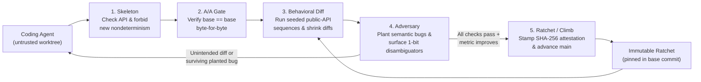

# EMI v2

**Prove what your coding agent actually changed — without trusting its unit tests.**

Coding agents write plausible code fast, and they write unit tests that agree with their own bugs even faster. **EMI v2** is a single, zero-dependency Rust binary that treats agentic coding as a deterministic control loop:

- **No unit-test policing** — compares `base` vs `candidate` directly through your public API.
- **No flaky noise** — verifies `base` vs `base` (A/A) is byte-for-byte deterministic before trusting any diff.
- **No blind trust in your checks** — plants semantic bugs to prove your oracle can actually catch real ones.
- **No tampering** — reads rules, approved diffs, and incident replay seeds strictly from the immutable `base` commit.

---

## How It Works



### The 5 Building Blocks

1. **Skeleton (`emi skeleton`)** — Extracts your public API surface (functions, structs/classes, state enums, complexity erosion) and flags ambient nondeterminism (`time.time()`, `random.*`, `SystemTime::now()`, `Math.random()`, etc.).
2. **Behavioral Diff (`emi diff`)** — Materializes clean `base` and `candidate` snapshots from git, verifies **A/A determinism** (`base == base`), proves any configured output masks aren't hiding bugs, runs seeded/stateful sequences, and **delta-shrinks** every divergence to the shortest reproducing call sequence.
3. **Adversary (`emi adversary`)** — *"An oracle that cannot catch a planted bug cannot catch a real one."* Injects semantic faults into changed code and checks whether your oracle kills them. If a fault survives, EMI finds the **single smallest input** where your candidate and the fault disagree so you can lock the right behavior in one click.
4. **Immutable Ratchet (`emi ratchet`)** — Stores policy (`off` / `observe` / `enforce`), approved diff IDs, masks, and diff-triggered incident replay seeds in `.emi/ratchet.json`, read exclusively from the pinned `base` commit (`git show <base>:.emi/ratchet.json`). Stamps every run with a SHA-256 attestation.
5. **Hillclimber (`emi climb`)** — Turns verification into an objective function for autonomous optimization loops (*"make this 10x faster"*). Accepts a change **only** if the hard correctness floor holds (`skeleton ∧ A/A ∧ parity ∧ planted bugs`) **and** your quantitative metric strictly improves.

---

## 60-Second Quick Start

### 1. Build (zero external crates — compiles in seconds)

```bash
cargo build --release
```

### 2. Verify EMI itself with 5,000 simulated worlds

EMI has **zero unit tests** and **zero comments** — it verifies itself via built-in Deterministic Simulation Testing:

```bash
./target/release/emi sim --seeds 5000
# SIM  ok=true  seeds=5000  worlds=5000  digest=9b290f61f911928c
```

### 3. Run on any repository

```bash
# Inspect your public API & nondeterminism surface
emi skeleton extract --repo .

# Pin an immutable baseline ratchet in git
emi ratchet init --repo . --mode observe
git add .emi/ratchet.json && git commit -m "pin emi ratchet"

# After an agent edits code, compute the exact Behavioral Diff
emi diff --repo . --parity --seeds 32

# Prove your oracle kills planted semantic bugs
emi adversary --repo . --max-faults 8 --seeds 24

# Run a monotonic optimization check (rejects 10x speedups that break parity)
emi climb --repo . --metric "python3 bench.py" --runs 5

# Record a SHA-256 verification attestation
emi ratchet stamp --repo .
```

Every command supports `--json` for structured agent/CI consumption.

---

## Example Output

When an agent tries a "10x faster" rewrite that silently breaks `fee(1)`:

```text
BEHAVIORAL DIFF  verdict=parity_fail  aa=true  masks=true  seqs=24  union_cov=154  unapproved=1
  [DIFF 8a3f91c2e410b7d1 | UNAPPROVED] ops=1
    call: {"args":[1],"op":"ledger.py::fee"}
    base:      {"error":null,"logs":[],"ok":true,"outcomes":[{"ok":true,"value":"1"}],...}
    candidate: {"error":null,"logs":[],"ok":true,"outcomes":[{"ok":true,"value":"0"}],...}

CLIMB  verdict=reject_floor  base=100.0000  cand=10.0000  ratio=10.00x
       detail=hard correctness floor failed; metric gain discarded
```

Once the agent fixes the bug while keeping the 10x speedup:

```text
BEHAVIORAL DIFF  verdict=pass  aa=true  masks=true  seqs=24  union_cov=152  unapproved=0
  parity verified

CLIMB  verdict=accept  base=100.0000  cand=10.0000  ratio=10.00x
       detail=floor held and metric improved (100.0000 -> 10.0000, 10.00x)
```

---

## Works With Any Language (2-Message Driver Protocol)

Out of the box, EMI auto-discovers Python functions with zero configuration. For **Rust, Go, TypeScript, C++, HTTP services, or full simulators**, pass `--driver <CMD>` pointing to any executable that reads JSONL on `stdin` and writes JSONL on `stdout`:

| Verb | Request (stdin) | Response (stdout) |
|---|---|---|
| `probe` | `{"verb":"probe"}` | `{"ok":true,"fingerprint":"v1","operations":[{"name":"put","arity":2,"stateful":true}],"detail":"ok"}` |
| `step` | `{"verb":"step","seed":42,"ops":[{"op":"put","args":["k1",1]}],"faults":[]}` | `{"ok":true,"outcomes":[true],"side_effects":[],"logs":[],"state_digest":"<sha256>","coverage":["src/kv.rs:42"],"error":null}` |

EMI keeps one persistent driver process open per snapshot so hundreds of sequences finish in milliseconds.

---

## Exit Codes

| Code | Meaning |
|---|---|
| `0` | **Pass / Accept** — parity held (and metric improved for `climb`) |
| `2` | **Error** — invalid usage, missing repo, or driver crash |
| `3` | **Code / Oracle Failure** — unapproved behavioral diff, broken skeleton, surviving planted bug, or `climb` floor failed |
| `4` | **Integrity Failure** — base failed A/A determinism check or a mask failed canary proof |
| `5` | **Environment Failure** — driver `probe` failed (infra issue, not code) |
| `6` | **Metric Rejected** — `climb` correctness floor held, but metric did not improve |
