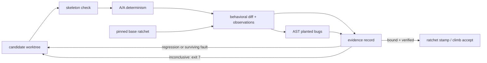

# emi

A small Rust CLI that checks what a code change actually does to your program's behavior, without relying on unit tests written by the same agent that wrote the patch.

Zero external crate dependencies. Builds in a few seconds with `cargo build --release`.

## Why

When an agent edits a repo and writes unit tests for its own patch, the tests usually pass even when the patch is wrong, because both came from the same misunderstanding.

`emi` skips the agent's unit tests and checks the change directly against a pinned baseline commit:

1. Checks whether public signatures broke or new ambient nondeterminism (`time.time`, `random`, `os.urandom`, `SystemTime::now`, `Math.random`, etc.) crept in.
2. Runs the old code against itself twice (and the new code against itself twice) to make sure the outputs are deterministic before trusting any comparison.
3. Feeds the same generated call sequences into both versions through your public API, compares return values plus any declared observable files or driver observations, and shrinks any behavioral difference down to the smallest reproducing call.
4. Mutates the changed executable lines in the AST to plant fake bugs and checks whether those calls actually catch them. If a fake bug slips through, `emi` hunts for a single input where your code and the mutant disagree.
5. Reads all rules, masks, observable-effect declarations, and regression cases from the pinned `base` commit (`git show <base>:.emi/ratchet.json`), never from the working tree the agent can edit.
6. Separates a real regression (`parity_fail`, exit `3`) from missing evidence (`inconclusive`, exit `7`), and lets `ratchet stamp` verify and preserve the evidence record `diff` already produced instead of re-running a weaker check.



## Build

```bash
cargo build --release
```

The binary is at `target/release/emi`.

To run the built-in simulation suite (1,000 seeded in-memory worlds plus 10 real temporary git/Python worlds):

```bash
./target/release/emi sim --seeds 1000
```

## Usage

Initialize a ratchet file and commit it on your base branch. You can also declare files whose bytes should be compared after every step, custom driver observations that must be present, and whether mutation evidence is required:

```bash
emi ratchet init --repo . --mode observe --allow-head \
  --observe-file journal.log \
  --require-observation rows_after_reopen \
  --require-mutations
git add .emi/ratchet.json && git commit -m "init emi ratchet"
```

Compare your working tree against a protected base ref (`--base`, `EMI_BASE_REV`, or `origin/main`; pass `--allow-head` for local scratch work) and write an evidence record bound to the exact candidate tree, base commit, driver, and policy:

```bash
emi diff --repo . --base origin/main --seeds 48 --parity --strict --with-adversary \
  --evidence-out .emi/evidence.json
```

Coverage requirements only count executable changed lines (comments, blank lines, and Python docstrings are ignored, so a docstring-only edit passes cleanly without fake coverage). In `--strict` or `enforce` mode, zero discovered operations, zero valid comparisons, zero executed executable lines, missing required observations, or missing required mutation evidence return `inconclusive` (exit `7`) rather than a green `pass`.

Check for API breaks or newly introduced nondeterminism (Python type-hint additions are ignored):

```bash
emi skeleton check --repo . --base origin/main --forbid-nondet
```

Run AST-based planted bugs on the changed executable lines (`git diff -U0`) and optionally attach the mutation counts directly to an existing evidence record:

```bash
emi adversary --repo . --base origin/main --max-faults 8 --evidence .emi/evidence.json
```

When a behavioral change is intentional, pair the input predicate with an expected output relation (`--expect`) so the rule only approves the exact behavior you meant, not any arbitrary change in that input range:

```bash
emi ratchet lock-rule --repo . --allow-head \
  --op "pricing.py::price" \
  --when "1000 <= price_input <= 5000" \
  --expect "candidate_price == base_price - 10"
```

If a change does not fit a relation, approve the exact witnessed diff ID instead (`emi ratchet approve <DIFF_ID>`).

Save a specific regression call sequence so it always replays when matching files change:

```bash
emi ratchet remember --repo . --allow-head \
  --id "stale-expire" \
  --trigger "pricing.py" \
  --ops '[{"op":"pricing.py::price","args":[1000]}]'
```

Run an optimization check (`climb`). `emi` copies the benchmark script from `base` into `candidate` so the candidate can't edit its own benchmark, verifies parity + skeleton + declared observations + planted bugs, runs interleaved `(base, cand)` pairs in randomized order, and only accepts if the 95% bootstrap CI is strictly above `1.0x` and meets `--min-effect` (default 5%). If a required observation (such as `rows_after_reopen`) is missing, `climb` returns `inconclusive` (exit `7`) before accepting any speedup:

```bash
emi climb --repo . --base origin/main --metric "python3 bench.py" --runs 9 --min-effect 0.05
```

Stamp a verification record from the evidence CI already produced (signed with HMAC-SHA256 if `EMI_SIGNING_KEY` or `--key-file` is set). `stamp` verifies that the base commit, candidate tree hash, driver digest, and policy digest still match the evidence; if anything changed, it refuses and asks for a fresh `emi diff`:

```bash
EMI_SIGNING_KEY="$CI_KEY" emi ratchet stamp --repo . --base origin/main --evidence .emi/evidence.json
```

Pass `--json` to any command for machine-readable output, and `--timeout-ms <MS>` (default `5000`) to set the per-call driver timeout.

## Using other languages and custom observations

If you don't pass `--driver`, `emi` uses a built-in Python driver that discovers top-level functions, classes, methods, type hints, and kwargs, reloading modules fresh on every step so module-level state doesn't leak between runs. Any files listed in `observed_files` (`--observe-file`) are automatically snapshotted, hashed (`exists`, `size`, `sha256`), compared, and restored between steps for both the built-in driver and custom drivers.

For Rust, Go, TypeScript, C++, or a database/service harness that checks reopen durability or other custom effects, pass `--driver <CMD>` pointing to any program that speaks two JSONL messages on stdio:

- `probe`: reads `{"verb":"probe"}`, prints `{"ok":true,"fingerprint":"v1","operations":[{"name":"Vault.put","arity":2,"stateful":true,"param_types":["str","int"],"kwarg_names":[]}],"detail":"ok"}`
- `step`: reads `{"verb":"step","seed":"42","ops":[{"op":"Vault.put","args":["k1",1]}],"faults":[],"observed_files":["journal.log"]}`, prints `{"ok":true,"outcomes":[true],"side_effects":[],"logs":[],"state_digest":"<sha256>","coverage":["file:line"],"observations":{"rows_after_reopen":5},"error":null}`

Every `step` must start from a clean state seeded by `seed` (sent as a decimal string so 64-bit seeds don't lose precision). If a symbol was removed, return an error entry in `outcomes` instead of crashing the driver.

## Exit codes

- `0` — pass / accept
- `2` — usage error, stale evidence (code, driver, or policy changed), unprotected `HEAD` in enforce mode, or driver crash/timeout
- `3` — unapproved behavioral diff, broken skeleton, surviving planted bug, or `climb` correctness floor failed
- `4` — `base` or `candidate` failed A/A determinism, or a mask failed canary verification
- `5` — driver `probe` failed
- `6` — `climb` correctness held, but the metric change was not significant or below `--min-effect`
- `7` — `inconclusive` (zero discovered operations, zero valid comparisons, zero executed executable lines, missing required observation, or missing required mutation evidence)
