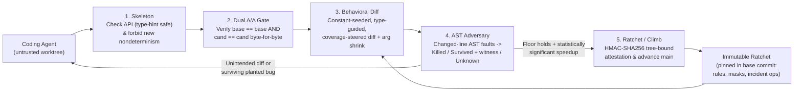

# EMI v2

**Prove what your coding agent actually changed — without trusting its unit tests.**

Coding agents write plausible code fast, and they write unit tests that agree with their own bugs even faster. **EMI v2** is a single, zero-dependency Rust binary that treats agentic coding as a deterministic control loop:

- **No unit-test policing** — compares `base` vs `candidate` directly through your public API (functions, classes, methods, and untracked new files).
- **No flaky noise** — verifies both `base` and `candidate` pass **A/A byte-for-byte determinism** before trusting any diff.
- **No blind trust in your checks** — plants AST-parsed semantic bugs on changed lines (`git diff -U0`) to prove your oracle can actually catch real ones.
- **Sealed trust boundary** — resolves a protected base (`--base`, `EMI_BASE_REV`, or `origin/main`), overlays base-pinned benchmarks during `climb`, reads rules strictly from `base`, and signs tree-bound attestations with HMAC-SHA256 (`EMI_SIGNING_KEY`).

---

## How It Works



### The 5 Building Blocks

1. **Skeleton (`emi skeleton`)** — Extracts public API signatures (normalizing Python type annotations so adding type hints does not false-fail), state enums, complexity erosion, and ambient nondeterminism (`time.time`, `perf_counter`, `random.*`, `os.urandom`, `secrets.*`, `uuid.*`, `SystemTime::now`, `Math.random`, etc.).
2. **Behavioral Diff (`emi diff`)** — Materializes clean `base` and `candidate` snapshots, checks A/A determinism on both sides, proves masks via adjacent canary mutations, extracts boundary constants (`c-1, c, c+1`) from changed code, runs type-guided + coverage-steered stateful sequences across the union of `base` + `candidate` operations, verifies changed lines were actually executed (`--require-cov`), and shrinks both call sequences and arguments to minimal reproductions.
3. **Adversary (`emi adversary`)** — Uses Python's `ast` module restricted strictly to changed lines (`git diff -U0`, never touching comments or string literals) with a fault budget. Reports `Killed`, `Survived` (with a constant-seeded minimal `DISAMBIGUATOR` witness), or `Unknown` (no distinguishing input found within budget).
4. **Immutable Ratchet (`emi ratchet`)** — Reads `.emi/ratchet.json` strictly from `git show <base>:.emi/ratchet.json`, checks `skeleton_digest`, evaluates **predicate approval rules** (e.g. `arg0 >= 1000 && arg0 <= 5000`) alongside exact diff IDs, replays diff-triggered incident sequences, and writes candidate-tree-bound **HMAC-SHA256** attestations (when `EMI_SIGNING_KEY` or `--key-file` is provided).
5. **Hillclimber (`emi climb`)** — Overlays benchmark/metric files from `base` onto `candidate` so the agent cannot game its own score, enforces the full correctness floor (`skeleton ∧ dual A/A ∧ parity ∧ real AST adversary`), runs **randomized interleaved** `(base, cand)` benchmark pairs, and requires both a **95% bootstrap confidence interval strictly above 1.0x** and a **minimum effect size** (`--min-effect`, default `5%`).

---

## 60-Second Quick Start

### 1. Build (zero external crates)

```bash
cargo build --release
```

### 2. Run EMI's built-in simulation suite (DST + real git/Python worlds)

EMI has **zero unit tests** and **zero comments** — `emi sim` runs 1,000 seeded in-memory worlds plus 6 effectful git/Python/timeout/HMAC/interleaved-climb worlds:

```bash
./target/release/emi sim --seeds 1000
# SIM  ok=true  seeds=1000  worlds=1006  effectful=6  digest=fa3b78f703f4694e
```

### 3. Run on any repository

```bash
# Inspect public API & nondeterminism surface
emi skeleton extract --repo .

# Pin an immutable baseline ratchet in git
emi ratchet init --repo . --mode observe --allow-head
git add .emi/ratchet.json && git commit -m "pin emi ratchet"

# Compute Behavioral Diff against a protected base (or --allow-head locally)
emi diff --repo . --base origin/main --parity --require-cov --seeds 48

# Approve an intentional behavioral change by input predicate rule
emi ratchet lock-rule --repo . --allow-head --op "pricing.py::price" --when "arg0 >= 1000 && arg0 <= 5000"

# Pin a concrete regression incident sequence
emi ratchet remember --repo . --allow-head --id "stale-expire" --trigger "pricing.py" \
  --ops '[{"op":"pricing.py::price","args":[1000]}]'

# Prove your oracle kills AST-parsed semantic faults on changed lines
emi adversary --repo . --base origin/main --max-faults 8 --seeds 32

# Run statistically significant interleaved hillclimbing (base-pinned benchmark)
emi climb --repo . --base origin/main --metric "python3 bench.py" --runs 9 --min-effect 0.05

# Record a tree-bound HMAC-SHA256 verification attestation
EMI_SIGNING_KEY="$CI_KEY" emi ratchet stamp --repo . --base origin/main
```

Every command supports `--json` and `--timeout-ms <MS>` (default `5000`).

---

## Driver Contract (Works With Any Language)

Out of the box, EMI auto-discovers Python top-level functions, classes, methods, type hints, and keyword arguments, reloading modules freshly on every `step` so module-level state never leaks across steps.

For **Rust, Go, TypeScript, C++, HTTP services, or full simulators**, pass `--driver <CMD>` pointing to any persistent JSONL-over-stdio executable obeying two rules:

1. **Fresh state per `step`** — every `step` must start from a clean, deterministic initial state seeded by `seed` (decimal string for lossless 64-bit seeds).
2. **Two JSONL verbs** — read one JSON line from `stdin`, flush one JSON line to `stdout`:

| Verb | Request (`stdin`) | Response (`stdout`) |
|---|---|---|
| `probe` | `{"verb":"probe"}` | `{"ok":true,"fingerprint":"v1","operations":[{"name":"Vault.put","arity":2,"stateful":true,"param_types":["str","int"],"kwarg_names":[]}],"detail":"ok"}` |
| `step` | `{"verb":"step","seed":"42","ops":[{"op":"Vault.put","args":["k1",1]}],"faults":[]}` | `{"ok":true,"outcomes":[true],"side_effects":[],"logs":[],"state_digest":"<sha256>","coverage":["pricing.py:12"],"error":null}` |

Missing/removed symbols should be returned inside `outcomes` (e.g. `{"ok":false,"exc":"MissingSymbol"}`) rather than crashing the driver. Hung calls are killed cleanly after `--timeout-ms`.

---

## Exit Codes

| Code | Meaning |
|---|---|
| `0` | **Pass / Accept** — parity & coverage held (and statistically significant speedup for `climb`) |
| `2` | **Error** — invalid usage, unprotected baseline in enforce mode, or driver crash/timeout |
| `3` | **Code / Oracle Failure** — unapproved behavioral diff, 0 changed lines executed, broken skeleton, surviving planted bug, or `climb` floor failed |
| `4` | **Integrity Failure** — `base` or `candidate` failed A/A determinism check or a mask failed canary proof |
| `5` | **Environment Failure** — driver `probe` failed (infra issue, not code) |
| `6` | **Metric Rejected** — `climb` correctness floor held, but gain was not statistically significant or below `--min-effect` |
