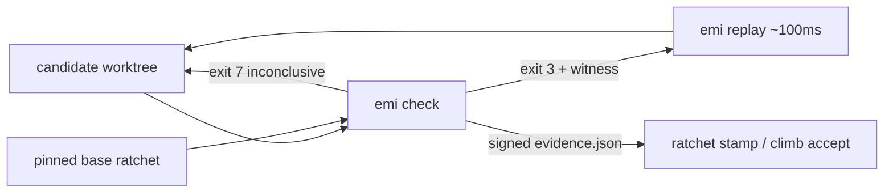

# emi

A small, agentic-first Rust CLI that checks what a code change actually does to your program's behavior, without relying on unit tests written by the same agent that wrote the patch.

Zero external crate dependencies. Builds in a few seconds with `cargo build --release`. See [GUIDE.md](GUIDE.md) for a step-by-step usage walkthrough (agent loop, CI evidence stamping, observable effects, `climb`, and custom drivers).

## Why

When an agent edits a repo and writes unit tests for its own patch, the tests usually pass even when the patch is wrong, because both came from the same misunderstanding.

`emi` skips the agent's unit tests and checks the change directly against a pinned baseline commit:

1. Checks whether public signatures broke or new ambient nondeterminism (`time.time`, `random`, `os.urandom`, `SystemTime::now`, `Math.random`, etc.) crept in.
2. Runs the old code against itself twice (and the new code against itself twice) in fresh forked processes to verify determinism before trusting any comparison.
3. Mines constants from changed files, their imported modules, and pinned rule bounds; spreads boundary inputs across all public functions; compares return values, exception types (ignoring message text), declared observed files, and custom observations; and shrinks divergences without collapsing unapproved bugs into approved rule ranges.
4. Mutates changed executable lines in the AST to plant fake bugs and checks whether the run actually catches them.
5. Reads all rules, masks, observable-effect declarations, and regression cases from the pinned `base` commit (`git show <base>:.emi/ratchet.json`), never from the working tree the agent can edit.
6. Separates real regressions (`parity_fail`, exit `3`) from missing evidence (`inconclusive`, exit `7`), emits structured `blocker`/`next_action` JSON fields for agent loops, and lets `ratchet stamp` verify signed, internally consistent evidence records bound to the exact candidate tree, driver, and policy.



## Install

**Linux / macOS** (downloads the verified prebuilt binary from GitHub Releases, or falls back to `cargo`):

```bash
curl -fsSL https://raw.githubusercontent.com/andrejksi/emiv2/main/install.sh | sh
```

**Windows (PowerShell)**:

```powershell
irm https://raw.githubusercontent.com/andrejksi/emiv2/main/install.ps1 | iex
```

**Cargo**:

```bash
cargo install --git https://github.com/andrejksi/emiv2
```

**Docker**:

```bash
docker build -t emi https://github.com/andrejksi/emiv2.git
docker run --rm -v "$PWD:/workspace" emi check --repo /workspace --base origin/main --json
```

**From source**:

```bash
cargo build --release
```

To run the built-in simulation and end-to-end suite (1,000 seeded in-memory worlds, 10 effectful git/Python worlds, and 8 black-box CLI adversarial trust-boundary worlds):

```bash
emi sim --seeds 1000
```

## Quickstart (agent loop)

Initialize a ratchet file and commit it on your base branch:

```bash
emi ratchet init --repo . --mode enforce --allow-head \
  --min-cov-ratio 0.5 \
  --observe-file journal.log \
  --require-mutations
git add .emi/ratchet.json && git commit -m "init emi ratchet"
```

Run the single-shot verification gate (`--strict` is on by default; pass `--no-strict` to relax):

```bash
EMI_SIGNING_KEY="$CI_KEY" emi check --repo . --base origin/main --seeds 48 --json
```

If `emi check` returns exit `3`, iterate quickly against only the failing shrunk witness with `emi replay` before re-running the full check:

```bash
emi replay --repo . --base origin/main --evidence .emi/evidence.json --json
```

When `emi check` returns exit `0`, stamp the signed attestation from the exact verified evidence record (refuses stale, unsigned, or internally inconsistent records):

```bash
EMI_SIGNING_KEY="$CI_KEY" emi ratchet stamp --repo . --base origin/main --evidence .emi/evidence.json
```

## Key commands

- `emi check` — single-shot pipeline (skeleton + strict behavioral diff + AST adversary + signed `.emi/evidence.json` + structured `blocker`/`next_action` JSON)
- `emi replay` — fast witness-only replay against current working tree
- `emi diff` — behavioral diff (`--strict` by default, `--min-cov-ratio`, `--observe-file`, `--require-observation`, `--with-adversary`, `--evidence-out`)
- `emi adversary` — AST-based planted bugs on executable changed lines (`--evidence` attaches mutation counts to existing evidence)
- `emi skeleton [extract|check]` — public API & ambient nondeterminism check
- `emi ratchet [init|status|approve|lock-rule|remember|stamp]` — pinned policy, `--expect` / `--must-hold` approval rules, incident memory, and evidence-bound HMAC attestations
- `emi climb` — statistically gated hillclimbing with base benchmark overlay, benchmark output parity (`{"metric": ..., "output": ...}` or multi-line output), and `inconclusive` gating on missing observations
- `emi sim` — deterministic simulation + real binary CLI e2e suite

## Built-in Python driver and custom drivers

Without `--driver`, `emi` uses a built-in Python driver that forks a fresh child process per step so all module/global/C state resets cleanly, imports modules by package name (supporting relative imports), scrubs `at 0x...>` memory addresses from `repr`, compares exception types rather than message text, and supports class factories (`__emi_init__` / `emi_factory`) plus typed `__init__` defaults.

For Rust, Go, TypeScript, C++, or database/service harnesses, pass `--driver <CMD>` speaking JSONL on stdio (`probe` and `step`, optionally emitting `"observations": {"rows_after_reopen": ...}`). See [GUIDE.md](GUIDE.md) for the exact protocol.

## Exit codes

- `0` — pass / accept
- `2` — usage error, stale/tampered/unsigned/inconsistent evidence, unprotected `HEAD` in enforce mode, or driver crash/timeout
- `3` — unapproved behavioral diff, `must_hold` rule violation, broken skeleton, surviving planted bug, or `climb` correctness/benchmark-output floor failed
- `4` — `base` or `candidate` failed A/A determinism, or a mask failed canary verification
- `5` — driver `probe` failed
- `6` — `climb` correctness held, but the metric change was not significant or below `--min-effect`
- `7` — `inconclusive` (0 ops, 0 valid comparisons, executable changed-line coverage below `--min-cov-ratio`, missing required observation, or missing required mutation evidence)
